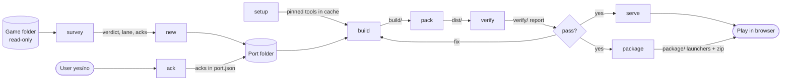

# Architecture

How port-any-game is put together: what the pieces are, how a game moves through them, what a port folder holds, and which layers keep the system inside its legal limits. Read [README.md](../README.md) and [SCOPE.md](../SCOPE.md) first for what the product is for. This page is the map; each section links to the doc that goes deeper.

## What the system is

port-any-game is a **skill plus a plugin** that helps a user play a PC game they own in a web browser. The agent (Claude Code, Codex, Copilot, OpenCode and other hosts) follows the skill's instructions. The skill drives a **zero-dependency Node CLI called `pag`** that does the real work: it inspects the game folder without running it, picks a conversion method (a lane), builds a private local web copy, checks the copy in a real browser and hands over a play link or double-click launchers.

Three things to hold on to:

- The **scripts are authoritative**. The skill text tells the agent what to do, but every refusal, every default and every file written is decided by code in `pag`. See [Defence in depth](#defence-in-depth).
- The **result is private**. Game files stay on the user's machine. Public use is gated on a rights statement the user makes themselves (see [safety-and-policy.md](safety-and-policy.md)).
- The repo root **is** the plugin (flat layout, [ADR 0001](adr/0001-flat-plugin-layout.md)). The whole repo is the install payload, so tests and docs ship with it.

## Components

| Component | Where | Role |
|---|---|---|
| Skill | [SKILL.md](../skills/port-any-game/SKILL.md), [references/](../skills/port-any-game/references/) | Agent-facing workflow (steps 0-10), ground rules, one reference per lane plus `legal.md`, `shell.md`, `verify.md`. Loaded on demand. |
| `pag` CLI | [scripts/pag.mjs](../skills/port-any-game/scripts/pag.mjs) and sibling modules | Dispatcher plus one module per command. Details in [cli.md](cli.md). |
| Lanes | [scripts/lanes/](../skills/port-any-game/scripts/lanes/) | One module per conversion method, plus a registry. See [lanes.md](lanes.md). |
| Survey, rules, catalog | [scripts/survey/](../skills/port-any-game/scripts/survey/), [scripts/rules/](../skills/port-any-game/scripts/rules/), [catalog/games.json](../skills/port-any-game/catalog/games.json), [catalog.mjs](../skills/port-any-game/scripts/catalog.mjs) | Static fingerprinting and the offline known-port catalog. See [survey-and-catalog.md](survey-and-catalog.md). |
| Shell assets | [assets/shell/](../skills/port-any-game/assets/shell/), [assets/lanes/](../skills/port-any-game/assets/lanes/) | The shared browser shell and each lane's adapter. See [runtime.md](runtime.md). |
| Verify | [scripts/verify/](../skills/port-any-game/scripts/verify/) | Serves a packed build, drives Chrome or Edge over CDP (Playwright as fallback) and judges the result. See [verify.md](verify.md). |
| Policy and guard | [policy.mjs](../skills/port-any-game/scripts/policy.mjs), [guard.mjs](../skills/port-any-game/scripts/guard.mjs) | One rule engine; the guard adapts agent hook payloads to it. See [safety-and-policy.md](safety-and-policy.md). |
| Project templates | [assets/project/](../skills/port-any-game/assets/project/) | Files `pag new` copies into each port folder, including the git hooks. |
| Host wrappers | [agents/](../agents/), [commands/](../commands/), [hooks/](../hooks/), [com.github.copilot/](../com.github.copilot/), [opencode/](../opencode/), [.claude-plugin/](../.claude-plugin/), [.codex-plugin/](../.codex-plugin/), [skills/port-any-game/agents/openai.yaml](../skills/port-any-game/agents/openai.yaml) | Per-agent packaging around the one skill. Mostly generated. See [agent-integration.md](agent-integration.md). |
| Repo tooling | [scripts/](../scripts/) (`gen-wrappers.mjs`, `install.mjs`, `validate.mjs`, `pin.mjs`) | Wrapper generator, installer for hosts without a marketplace, repo contract checker, pin helper. |
| Toolchain lock | [toolchain.lock.json](../skills/port-any-game/scripts/toolchain.lock.json) | Pinned runtime downloads (Ruffle, js-dos, Playwright): version, URL, SHA-256, licence. Used by `pag setup` and `pag pack`. |
| Tests | [test/](../test/) | Node's built-in runner; fixtures under `test/fixtures`. See [development.md](development.md). |

### The `pag` CLI and its modules

[pag.mjs](../skills/port-any-game/scripts/pag.mjs) is a table of command name to lazy `import()`. Each module exports `run(argv)` and returns the exit code; adding a command is one line. Unknown commands exit 2, `--help` exits 0.

| Command | Module | Purpose |
|---|---|---|
| `survey` | [survey/survey.mjs](../skills/port-any-game/scripts/survey/survey.mjs) | Static scan of a game folder; verdict and lane ranking. |
| `new` | [new.mjs](../skills/port-any-game/scripts/new.mjs) | Create the port folder. |
| `ack` | [ack.mjs](../skills/port-any-game/scripts/ack.mjs) | Record a user acknowledgement in `port.json`. |
| `setup` | [setup.mjs](../skills/port-any-game/scripts/setup.mjs) | Install pinned runtimes into the cache (`core`, `ruffle`, `jsdos`, `playwright`). |
| `build` | [build.mjs](../skills/port-any-game/scripts/build.mjs) | Call the port's lane `build()`. |
| `pack` | [pack.mjs](../skills/port-any-game/scripts/pack.mjs) | Assemble `dist/`. |
| `verify` | [verify/verify.mjs](../skills/port-any-game/scripts/verify/verify.mjs) | Run and judge a packed build. |
| `serve` | [serve.mjs](../skills/port-any-game/scripts/serve.mjs) | Static server for `dist/`. |
| `package` | [package.mjs](../skills/port-any-game/scripts/package.mjs) | `dist/` plus launchers, and a zip. |
| `doctor` | [doctor.mjs](../skills/port-any-game/scripts/doctor.mjs) | Machine report: Node, git, browsers, disk. |
| `status` | [status.mjs](../skills/port-any-game/scripts/status.mjs) | Where a port stands; runs at session start. |
| `guard` | [guard.mjs](../skills/port-any-game/scripts/guard.mjs) | Agent hook adapter for the policy engine. |

`status` and `guard` are special in the dispatcher: if their module fails to load, the dispatcher swallows the error and exits 0 (see [fail-open hooks](#design-principles)). Shared helpers live in [lib/fsx.mjs](../skills/port-any-game/scripts/lib/fsx.mjs) (walking, hashing, the cache dir) and [lib/archive.mjs](../skills/port-any-game/scripts/lib/archive.mjs) (zip, tgz, asar).

The cache directory is `$PAG_CACHE` if set, else `~/.port-any-game`. It holds downloaded tools (`tools/<name>-<version>`) and the salt used to hash game paths in survey output.

### Lanes

A lane is a conversion method. Each module in `scripts/lanes/` is a descriptor: `id`, `rung`, `available`, `milestone`, `dataModes`, `acks`, `odds`, `detect(survey)`, and for available lanes `build(portDir)`, `shell(port)` (defaults for `shell.json`) and a runtime description. The registry [lanes/index.mjs](../skills/port-any-game/scripts/lanes/index.mjs) collects them and `rankLanes()` orders the ones that apply: GO before HARD, then lower rung, then `known-port` first.

Six lanes are available: four from M1 and two from M2 (`rt-easyrpg`, `rebuild-love`):

| Lane | Rung | Data mode | What `build` does |
|---|---|---|---|
| `web-extract` | 0 | bundled | Extracts the already-web game to `build/game/` and scans for Node and Steam API use. |
| `known-port` | 0 | byo | External: routes to an existing web port; nothing to pack. |
| `rt-ruffle` | 1 | byo | Checks Ruffle is installed; records the SWF in `build/lane.json`. |
| `dos-jsdos` | 1 | byo | Checks js-dos is installed; records the executable in `build/lane.json`. |
| `rt-easyrpg` | 1 | byo | Checks EasyRPG Player is installed; records the game folder, encoding and RTP need in `build/lane.json`. |
| `rebuild-love` | 3 | byo | Checks love.js is installed; finds the `.love` (or fused exe) and records it, its zip offset and LÖVE version in `build/lane.json`. |

All other lanes in [stubs.mjs](../skills/port-any-game/scripts/lanes/stubs.mjs) are descriptors with `available: false` and a target milestone; `pag new` refuses them. Per-lane detail is in [lanes.md](lanes.md).

### Policy and guard

[policy.mjs](../skills/port-any-game/scripts/policy.mjs) is the single guardrail. Every `pag` command that can cross a line calls it (`assertLaneAllowed` in `new`, `isPublicAllowed` and `PolicyError` in `pack`, `assertTarget` in `serve`), and so does every agent hook. `checkToolUse()` inspects a proposed shell command, file write or URL fetch and returns allow or deny with a reason. [guard.mjs](../skills/port-any-game/scripts/guard.mjs) normalises hook payloads from many hosts into that one shape and prints a denial in the host's own format. A policy refusal exits 4.

### Host wrappers

One skill, many hosts. The canonical subagents are [agents/game-surveyor.md](../agents/game-surveyor.md) and [agents/port-verifier.md](../agents/port-verifier.md) (Claude format). [gen-wrappers.mjs](../scripts/gen-wrappers.mjs) generates the Copilot and OpenCode copies; `--check` fails on drift and `validate.mjs` runs it. Hook configs: [hooks/hooks.json](../hooks/hooks.json) (Claude Code), [hooks/codex.json](../hooks/codex.json), [com.github.copilot/hooks/hooks.json](../com.github.copilot/hooks/hooks.json), and an OpenCode plugin in [opencode/plugin/](../opencode/plugin/). All of them call `pag guard --host=<x>` before tool use and `pag status` at session start. [install.mjs](../scripts/install.mjs) covers hosts without a marketplace.

## End-to-end pipeline



| Step | Command | Reads | Writes | Notes |
|---|---|---|---|---|
| Survey | `pag survey <game> [--json] [--out file]` | Game file headers only (never executes) | stdout; the `--out` file if asked | Exit 0 GO or HARD, 4 STOP. Output holds relative paths and a salted root id, never absolute paths. |
| New | `pag new <game> <port> [--lane id] [--resume]` | Survey (re-run internally), [assets/project/](../skills/port-any-game/assets/project/) | The port folder (see [layout](#the-port-folder)) | Refuses a STOP verdict, an unavailable lane, and bad folder placement. Never commits, never records an ack. |
| Ack | `pag ack <ID> [port]` | `port.json` | `port.json` (`acks[]`) | Only pag writes `port.json`. Run only after the user answered yes. |
| Setup | `pag setup <name> [--yes]` | [toolchain.lock.json](../skills/port-any-game/scripts/toolchain.lock.json) | `<cache>/tools/<name>-<version>/` | Without `--yes` it only prints what it would download. SHA-256 is verified before extraction. |
| Build | `pag build [port]` | `port.json`, `survey.json`, `game/` | `build/` (lane specific) | `web-extract` writes `build/game/`; Ruffle and DOS write `build/lane.json`. |
| Pack | `pag pack [port] [--mode m]` | `port.json`, lane, cached tool, `build/game/` or `game/` | `dist/` (built in `work/`, then swapped in) | See below. |
| Verify | `pag verify <dist> [--soak n]` | `dist/`, `shell.json` | `verify/report.json`, `verify/step-*.png`, `verify/console.log` | Exit 0 pass, 1 fail, 2 warnings only, 3 unsupported environment. |
| Serve | `pag serve <dist> [--open]` | `dist/`, `_headers` | nothing | Loopback by default; `--lan` needs a password and an ack. |
| Package | `pag package [port]` | `dist/`, [assets/launchers/](../skills/port-any-game/assets/launchers/) | `package/<id>-portable/` and `package/<id>.zip` | For players without any tools. |

### What pack produces

[pack.mjs](../skills/port-any-game/scripts/pack.mjs) builds `dist/` in `work/pack-tmp-<pid>` and renames it into place, so a failed pack leaves the previous `dist/` whole. Contents:

- `index.html` and `shell/*`: the shared web shell, copied unminified from [assets/shell/](../skills/port-any-game/assets/shell/).
- `runtime/<lane>-<hash8>/`: the lane adapter plus the pinned runtime files. The folder name hashes paths and bytes, so `/runtime/*` can be served immutable.
- `shell.json`: the contract between pack and shell (lane, entry adapter, requirements, memory, input, video, data mode, verify targets). Lane defaults come from the lane's `shell()` merged over built-in defaults.
- `pag-manifest.json`: file list with sizes and SHA-256 hashes. Lives outside `game/` so a game's own `manifest.json` is just a game file.
- `game/`: the game files, except in `byo` mode where the user supplies them in the browser.
- `_headers`, `robots.txt`, `LICENSES/`: security headers and CSP, a disallow-all robots file, and licence texts for the shell and the runtime.

The source of game files is `build/game/` when it exists, else `game/`. Lanes with `requiresBuild` (`web-extract`) refuse the raw install. Link handling, case-collision checks and header details are in [runtime.md](runtime.md).

### What serve and package do with it

`serve` is a static server with no dependencies. It binds `127.0.0.1` unless `--lan` is given, takes response headers only from `dist/_headers`, and uses a stable per-game port (`stablePort`) so the browser origin (and its saved data) stays the same between sessions. `package` copies `dist/` next to launchers for Windows, macOS and Linux; each launcher serves `dist/` on loopback and opens the browser.

## The port folder

`pag new <game> <port>` creates the port as its own git repository. It writes only files that are missing, so `--resume` restores deleted project files without touching anything the user or agent changed.

```
<port>/
  port.json            identity, lane, data mode, acknowledgements (written only by pag)
  survey.json          the survey result at creation time
  game                 link (junction on Windows, symlink elsewhere) to the user's real install
  AGENTS.md            port rules for any agent
  CLAUDE.md            one line: @AGENTS.md
  PORTING_LOG.md       checklist from the lane, then dated log entries
  .gitignore           game/ work/ build/ dist/ analysis/ verify/ node_modules/ package/
  .githooks/           pre-commit, pre-push, check-staged.mjs (core.hooksPath points here)
  lane/                tracked home for the agent's own code (.gitkeep)
  --- created later, all git-ignored ---
  build/               lane build output (build/game/, build/lane.json)
  work/                scratch, including pack's temp folders
  dist/                the packed web build
  verify/              report.json, screenshots, console.log
  package/             portable folder and zip
```

Details worth knowing:

- **`port.json`** has `schema: "port-any-game/port@1"`, `id` (slug of the title or folder name; a name with no ASCII letters or digits becomes `game-<sha8>`), `name`, `lane`, `data` (`mode`, and `redistributable: true` only when every confident catalog match says the data is free to share), `tools`, `acks` and `created_at`. `data.mode` starts as the lane's first data mode. The lane never changes; another lane needs a new port folder. Code: [new.mjs](../skills/port-any-game/scripts/new.mjs).
- **`game`** is a link to the original install, not a copy. Nothing may write into it, and recursive deletes of the port folder can follow it. `AGENTS.md` and the skill both forbid deleting a port; the policy engine also screens recursive delete commands.
- **Placement is checked** (`checkPlaces`): the port may not be inside the game folder or the reverse, and not inside the skill folder.
- **Git**: `new` runs `git init` and sets `core.hooksPath` to `.githooks`. If git is missing it warns and still creates the folder. It never commits.
- **Templates** come from [assets/project/](../skills/port-any-game/assets/project/): [AGENTS.md](../skills/port-any-game/assets/project/AGENTS.md), [CLAUDE.md](../skills/port-any-game/assets/project/CLAUDE.md), [gitignore](../skills/port-any-game/assets/project/gitignore), [PORTING_LOG.md](../skills/port-any-game/assets/project/PORTING_LOG.md) and [githooks/](../skills/port-any-game/assets/project/githooks/). The log's name, lane and checklist are filled in from the lane descriptor.
- **Git hooks** block game magic bytes, survey hashes and binaries over 5 MiB in staged files (pre-commit) and in commits being pushed (pre-push). [check-staged.mjs](../skills/port-any-game/assets/project/githooks/check-staged.mjs) is standalone, with no dependency on the skill. It stands down only when the data may be public (`redistributable` or a recorded `ACK_RIGHTS_HOLDER`), the same rule as `isPublicAllowed` in policy.

## Data modes

Every packed build has a data mode, recorded in `shell.json` and `port.json`.

| Mode | Game files | Typical lane | Sharing |
|---|---|---|---|
| `byo` (bring your own) | Not in `dist/`. On first start the user picks the game folder; the shell copies it into the browser's storage (OPFS). Nothing is uploaded. | `rt-ruffle`, `dos-jsdos`, `rt-easyrpg`, `rebuild-love` | A build with no game files; the user still owes runtime licence duties. |
| `bundled` | Copied into `dist/game/`. | `web-extract` | Private copy only. |
| `bundled-public` | Copied into `dist/game/`, for a build meant to be shared. | Any lane | Allowed only when rights are established (`isPublicAllowed`). `pack` then persists the mode to `port.json`. |

Pack accepts `byo` and `bundled` only if the lane lists them in `dataModes`; `bundled-public` is lane-independent and gated by policy. The legal reasoning, the acknowledgement IDs and the rule that only the user can state rights are in [safety-and-policy.md](safety-and-policy.md).

## Defence in depth

Four layers, ordered from softest to hardest. Each assumes the one before it can fail.

| Layer | Where | What it does | Can it be bypassed? |
|---|---|---|---|
| 1. Skill text | [SKILL.md](../skills/port-any-game/SKILL.md) ground rules, [legal.md](../skills/port-any-game/references/legal.md) | Tells the agent what to refuse, what to warn about, and which acknowledgements to ask for. | Yes: it is advice to a model. |
| 2. Script checks | [policy.mjs](../skills/port-any-game/scripts/policy.mjs) called from `new`, `pack` and `serve`; the survey STOP verdict | Refuses regardless of what the agent was told. Exit 4. | No, short of editing the scripts. |
| 3. Agent hooks | `pag guard` on `PreToolUse`; `pag status` on session start | Denies circumvention commands, writes into protected port folders, edits to `port.json`, and piracy-domain fetches before the tool runs. | Only on hosts or routes without working hooks, and it fails open by design. |
| 4. Git hooks | `.githooks/` in the port | Stops game bytes from being committed or pushed. | By `--no-verify` or changing `core.hooksPath`, which the port rules and the guard forbid. |

The protected port folders in policy are `game`, `work`, `build`, `analysis`, `dist`, `extracted` and `recomp`. Layers 2 and 4 hold even when 1 and 3 do not, which is why the scripts, not the prompt, are the source of truth.

## Design principles

- **Zero runtime dependencies.** The `pag` CLI uses only Node built-ins (`node:fs`, `node:http`, `node:util` `parseArgs`, global `fetch` and `WebSocket`). Playwright is an optional downloaded tool, used only when no Chrome or Edge exists.
- **Node ESM.** `"type": "module"`, Node 20.12 or newer (22 recommended). Install and run need no `npm install`.
- **Cross-OS.** Windows, macOS and Linux are first-class: junction versus symlink for `game`, case-insensitive path comparison on Windows and macOS, PowerShell and sh variants of every instruction, per-OS launchers, per-OS browser discovery.
- **Fail-open hooks.** A hook that crashes must not break the user's session. `pag guard` and `pag status` exit 0 with no output on internal errors or load failures. The cost is accepted because the scripts (layer 2) and git hooks (layer 4) still hold.
- **Scripts are authoritative.** Policy lives in code and is tested. The skill and wrappers point at it and never restate a rule differently.
- **Static first, never execute the game.** Survey reads headers with bounded work; only the user's own browser runs game code, inside a CSP-restricted shell.
- **Idempotent, non-destructive.** `new --resume` writes only missing files; `pack` swaps `dist/` atomically; `ack` repeats are no-ops; `setup` needs `--yes` to download.
- **One spec, many hosts.** Wrappers are generated from canonical files and checked for drift.

## Where to read next

| If you want to | Read |
|---|---|
| Use or change a command | [cli.md](cli.md) |
| Understand how a game is classified | [survey-and-catalog.md](survey-and-catalog.md) |
| Work on or add a lane | [lanes.md](lanes.md) |
| Change the browser shell, headers, saves or serving | [runtime.md](runtime.md) |
| Understand what verify checks and its exit codes | [verify.md](verify.md) |
| Touch legal behaviour, acks or hooks | [safety-and-policy.md](safety-and-policy.md) |
| Support another agent host | [agent-integration.md](agent-integration.md) |
| Set up a dev machine, run tests, release | [development.md](development.md) |
| Know why something is the way it is | [decisions.md](decisions.md), then [adr/](adr/) and the [design spec](superpowers/specs/2026-11-17-port-any-game-design.md) |
| See what is built and what is next | [roadmap.md](roadmap.md) |

The full index, including research notes and spikes, is [README.md](README.md).
