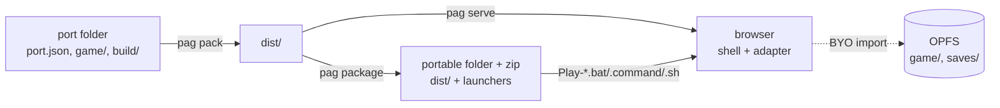

# Runtime: the web shell, the build, serving and packaging

This document covers what runs in the player's browser and how it gets there: the shared web shell, the
`shell.json` contract, the `dist/` layout `pag pack` writes, response headers and CSP, the bring-your-own (BYO) import,
saves, `pag serve` and `pag package`. For checking a build see [verify.md](verify.md); for the lane-specific
adapters see [lanes.md](lanes.md). The agent-facing short form is
[references/shell.md](../skills/port-any-game/references/shell.md).

## The pieces

| Piece | Where | Runs |
|---|---|---|
| Web shell | [assets/shell/](../skills/port-any-game/assets/shell/) | In the player's browser. One copy per build, shared by every lane. MIT, shipped unminified. |
| Lane adapter | [assets/lanes/\<lane\>/adapter.js](../skills/port-any-game/assets/lanes/) | In the browser, imported by the shell. Wraps one runtime (Ruffle, js-dos, an iframe). |
| `pag pack` | [pack.mjs](../skills/port-any-game/scripts/pack.mjs) | Node. Assembles `<port>/dist/`. |
| `pag serve` | [serve.mjs](../skills/port-any-game/scripts/serve.mjs) | Node. Static server for `dist/`. |
| `pag package` | [package.mjs](../skills/port-any-game/scripts/package.mjs) | Node. Wraps `dist/` with launchers into a folder and a zip. |
| Launchers | [assets/launchers/](../skills/port-any-game/assets/launchers/) | On the player's machine, no plugin code. |

A build never talks to the network beyond same-origin GETs of its own files.



## The web shell

Files in [assets/shell/](../skills/port-any-game/assets/shell/): `index.html`, `shell.css`, `shell.js` (lifecycle),
`import.js` (BYO import and its Worker), `storage.js` (OPFS, saves, self-test), `input.js`, `audio.js`, `pure.js`
(DOM-free helpers shared with the Worker and the Node tests), `zip.js` (store-method zip writer). `pack` copies
`index.html` to `dist/index.html` and the rest to `dist/shell/`.

### Boot sequence

`boot()` in [shell.js](../skills/port-any-game/assets/shell/shell.js) runs on `DOMContentLoaded`, or immediately if the
document is already past loading:

1. Read the verify hooks from `location.search` (`verify_import`, `verify_interrupt_after`, `verify_stage`).
2. Publish `window.__shell` (stats, `state`, `lane`, `storage`, `debug.captureFrame`). Install the page-error
   handlers (`error`, `unhandledrejection`), the audio tap, the input counters and a resource observer that sums
   `.wasm` sizes.
3. Put a live placeholder canvas under the overlay and start the `requestAnimationFrame` tick. This is the
   "no black screen" rule: something animates from the first frame, before any lane code loads.
4. State `checking`. Fetch `shell.json` (`cache: no-store`); reject any `schema` other than `1`.
5. Capability check (see below). Missing items raise `Unsupported environment: this browser lacks ...`.
6. Fetch `pag-manifest.json`.
7. BYO: `checkByo()`. If every manifest file already has a `.done` marker, go straight to `ready`; otherwise
   `needs-files` (or, with `?verify_import`, import the fixture automatically). Bundled: `ready`.
8. The Play click: create the `AudioContext` synchronously inside the click, `import()` the adapter named by
   `entry.adapter`, call `adapter.start(ctx)`, then `running`.

### State machine

`body[data-state]` mirrors the state and drives CSS (which layer shows). `setState` is the only way to change it and
fires a `shell:state` event on `window` with `{state, prev}`.

| State | Meaning |
|---|---|
| `boot` | Page loaded, nothing run yet. |
| `checking` | Reading `shell.json`, capability check, manifest, OPFS completeness. |
| `needs-files` | BYO only: waiting for the player's game folder (button, classic chooser or drop). |
| `importing` | Copying and hashing files into OPFS; shows a progress bar. |
| `downloading` | Declared but not set by the current shell. |
| `ready` | Everything present; the Play button shows. |
| `running` | Adapter started; the overlay is hidden. |
| `paused` | Tab hidden while running; the adapter's `pause()` was called. |
| `error` | Error layer visible. |

`error` is entered through `reportError(err, where)`, which logs, fills the error text and an explanation
(`explain()` special-cases `file://`, cross-origin isolation and WebGL/WebGPU/SIMD/JSPI messages).
Layer order is fixed in [shell.css](../skills/port-any-game/assets/shell/shell.css): game host 0, overlay 1, error 2.

Page errors are treated by phase. Before Play they are fatal. While the game runs (`running` or `paused`) they are
logged and kept in `stats.lastError`; they become the error screen only if the game loop then stops: `stallWatch`
([pure.js](../skills/port-any-game/assets/shell/pure.js)) returns the first error once no game frame has followed it
for 3 s. A tab that becomes visible again restarts that clock.

### Capability check

`missingCapabilities(requires, needs_coi, byo)` reports each of these as missing:

| Need | Test |
|---|---|
| OPFS (BYO only) | `navigator.storage.getDirectory` exists (needs https or localhost) |
| `requires.webgl2` | a `webgl2` context can be created |
| `requires.webgpu` | `navigator.gpu` |
| `requires.threads` or `needs_coi` | `crossOriginIsolated` and `SharedArrayBuffer` |
| `requires.simd` | `WebAssembly.validate` on an `i8x16.popcnt` probe |
| `requires.jspi` | `'Suspending' in WebAssembly` |

verify maps the `Unsupported environment` message to exit 3, not to a port failure.

### Adapter contract

An adapter is the default export of `runtime/<lane>-<hash8>/adapter.js`. The shell calls it as follows.

| Member | Required | Notes |
|---|---|---|
| `start(ctx)` | yes | `ctx` = `{host, files, audio: {context}, reportFrame, reportError, reportPageError, config}`. May resolve before anything is painted. |
| `pause()`, `resume()` | no | Called on tab hide/show. Errors are caught and reported. |
| `frameCounter()` | recommended | Monotonic game-frame count; the shell takes the max of this and its own counter every frame. |
| `saveNow()` | no | Flush the lane's own saves. Called by `__shell.storage.exportSaves()` and by verify. |

`ctx.files` has `list()`, `url(path)` and `read(path)`. For BYO the data is OPFS `File` snapshots (`url` gives a
`blob:` URL); for bundled builds it is `game/<path>` over HTTP. Names are matched exactly first, then
case-insensitively when exactly one entry folds to the request.

`reportFrame()` must be called only for frames the game actually drew. That count is what verify's fps, blank and
loop checks rest on. `reportError()` is fatal; `reportPageError()` is the softer path described above (the
web-extract adapter routes the game's own uncaught errors there). Adapters must not touch the DOM at module top
level, because the Node tests import some of them.

Adapters today: [rt-ruffle](../skills/port-any-game/assets/lanes/rt-ruffle/adapter.js) (Ruffle player in the host,
frames counted from rendered movie time, unwraps Flash projectors),
[dos-jsdos](../skills/port-any-game/assets/lanes/dos-jsdos/adapter.js) (js-dos raw emulators API, bundle zipped in the
browser, own key routing),
[web-extract](../skills/port-any-game/assets/lanes/web-extract/adapter.js) (same-origin iframe on `game/index.html`,
frames and errors from an injected `__pag_hook.js`). See [lanes.md](lanes.md).

### Input

[input.js](../skills/port-any-game/assets/shell/input.js) only does accounting and protection; the lane does the
real input handling.

- Counts `keydown` (capture), `keyup`, `pointerdown`, `pointerup`, `wheel`, `touchstart` into
  `stats.inputEvents`.
- While `running`, `preventDefault()` on arrows, Space, Tab and F1-F12 so the page does not scroll or lose focus.
- Polls gamepads once per animation frame (standard mapping) and counts one event per state change.
- No pointer lock, keyboard lock or touch overlay yet. The web-extract adapter mirrors keyboard and pointer events
  from its iframe up to the shell so the counters and key protection still work.

### Audio

[audio.js](../skills/port-any-game/assets/shell/audio.js): one `AudioContext` created inside the Play click and
resumed there (autoplay policy), suspended while the tab is hidden. `installAudioTap()` wraps
`AudioNode.prototype.connect` so anything connected to any context's destination also feeds an analyser; that is how
`stats.audioRms` is measured even for runtimes that create their own context.

### Storage helpers

[storage.js](../skills/port-any-game/assets/shell/storage.js) exposes through `window.__shell.storage`:

- `selfTest()`: writes and reads a `.pag-selftest` file in OPFS, reports `{ok, opfs, persisted, usage, quota}`.
- `exportSaves()` / `importSaves(blob)`: a stored zip of the OPFS saves folder (`opfs/...`) plus this origin's
  `localStorage` (`localStorage.json`). These are API functions only; there is no button in the page yet.
- `persist()` is asked for after a successful import so the browser does not evict the files (Safari evicts after
  7 days without a visit otherwise).

## `shell.json`

Written by `pack` ([shellJson()](../skills/port-any-game/scripts/pack.mjs)) from fixed defaults merged with what the
lane's `shell(port, {portDir})` function returns. Nothing else writes it. Served `no-cache`.

| Field | Written as | Read by |
|---|---|---|
| `schema` | `1` | shell (rejects others), verify static check |
| `game_id` | `port.id` | shell (title), verify |
| `lane` | lane id | verify, package |
| `entry.adapter` | `runtime/<lane>-<hash8>/adapter.js` | shell |
| `requires` | `{webgl2, webgpu, threads, simd, jspi}`, all `false` unless the lane sets them | shell capability check |
| `needs_coi` | lane's `needs_coi`, else `requires.threads === true` | `pack` (headers), shell, verify, package (`launch.json`) |
| `memory` | `{initial_mb: 64, maximum_mb: 512}` | recorded only; the shell does not read it today |
| `data` | `{mode, manifest: "pag-manifest.json", mount: "/game", saves: "/saves/<id>"}` | shell (`mode`, `manifest`, `saves`); `mount` is unused today |
| `input` | `{keyboard: true, mouse: "absolute", gamepad: "standard", touch: false}` | recorded only |
| `video` | `{aspect: "4:3", scaling: "fit"}` | recorded only |
| `serve.caseFallback` | only if the lane sets `serve` (web-extract: `true`) | `serve`, `verify`, `package` |
| `lane_config` | only if the lane sets it (Ruffle `{swf, projector}`, DOS `{exe}`, from `build/lane.json`) | the adapter |
| `csp` | only if the lane sets it (web-extract: `script-src += 'unsafe-eval' 'unsafe-inline'`) | `pack` (headers), verify (info line) |
| `verify` | `{target_fps: 30, inputs: [], audio_on_title: false, budget_ready_s: 15}` merged with the lane's | verify; `stages` is optional |

Lane overrides in the tree: Ruffle and DOS set `verify.inputs = ['Click','Enter','Space']` and
`budget_ready_s: 30`; DOS also pins `needs_coi: false`; web-extract sets arrow-key inputs and the CSP relaxation.
No M1 lane currently needs cross-origin isolation, so no built `_headers` carries COOP/COEP yet.

## `pag pack` output

`pag pack [portDir] [--mode byo|bundled|bundled-public]` (exit 0 ok, 1 failure, 2 usage, 4 policy refusal).
The mode defaults to `port.json` `data.mode`, then `byo`. It must be in the lane's `dataModes`, except
`bundled-public`, which any lane can use if `isPublicAllowed(port)` passes (see
[safety-and-policy.md](safety-and-policy.md)). The first successful `bundled-public` pack rewrites `port.json`
`data.mode` so the port is public from then on.

```
dist/
  index.html            shell page
  shell/                shell.js, import.js, storage.js, pure.js, input.js, audio.js, zip.js, shell.css
  shell.json            see above
  pag-manifest.json     {version, source, total_bytes, files:[{path,size,sha256,partial?}]}
  game/...              game files, bundled and bundled-public only
  runtime/<lane>-<hash8>/   adapter.js + the pinned runtime files
  LICENSES/             port-any-game-shell.txt, <runtime-tool>.txt
  _headers              Netlify-style headers
  robots.txt            Disallow: /
```

Details worth knowing:

- **Game files** come from `build/game` when it exists, else `game/`. Lanes with `requiresBuild` (web-extract) refuse
  to pack without `build/game`. Files are walked in sorted order, OS litter (`.DS_Store`, `Thumbs.db`,
  `desktop.ini`) is skipped, names are NFC-normalised, and a symlink must resolve inside the game folder or the pack
  fails. Names with backslashes or dot segments, or two names that differ only by case, are refused.
- **Hashing** uses the same function as the survey: SHA-256 of the whole file, or for files over 256 MiB only the
  first and last 1 MiB, flagged `partial: true`. The in-browser import hashes the same way (`fileHasher`).
  `manifest.version` is a hash over `path\0size\0sha256` lines. `manifest.source` is `game` or `build/game`.
- **Hashed runtime folder.** The folder name is `<lane>-<first 8 hex of sha256>` over the sorted relative paths and
  bytes of the adapter plus the pinned runtime files. Because the name changes with the content,
  `/runtime/*` can be served `immutable` for a year, and `shell.json` (never cached) points at the current folder.
  The runtime tool must already be installed (`pag setup ruffle|jsdos --yes`).
- **Atomic swap.** The build is written under `<port>/work/pack-tmp-<pid>` and renamed over `dist/`; on failure the
  old `dist/` is restored, and a BYO pack never keeps game bytes from an earlier bundled one.
- **Licences.** `LICENSES/` gets the shell's MIT text and one notice per runtime tool (GPL tools also get the
  source pointer; GPL-2.0 gets the full text). Keep it with any copy that is shared.

## Headers and CSP

`headersFor(shell)` in [pack.mjs](../skills/port-any-game/scripts/pack.mjs) writes `_headers`:

| Header | When |
|---|---|
| `Cross-Origin-Opener-Policy: same-origin`, `Cross-Origin-Embedder-Policy: require-corp` | only when `needs_coi`. Never `credentialless` (Safari lacks it); verify fails the build if it appears. |
| `Cross-Origin-Resource-Policy: same-origin` | always |
| `Content-Security-Policy` | always, see below |
| `X-Content-Type-Options: nosniff`, `Referrer-Policy: no-referrer` | always |
| `X-Robots-Tag: noindex, nofollow` | every mode except `bundled-public` (the server still adds it on every response) |
| `Cache-Control: no-cache` | `/index.html`, `/shell.json`, `/pag-manifest.json` |
| `Cache-Control: public, max-age=31536000, immutable` | `/runtime/*` |

Base CSP:

```
default-src 'self'; script-src 'self' 'wasm-unsafe-eval'; worker-src 'self' blob:; connect-src 'self';
img-src 'self' data: blob:; media-src 'self' blob:; style-src 'self' 'unsafe-inline'; frame-ancestors 'self'
```

**Lane relaxations (R61).** A lane may add keywords to a directive the base policy already has, through
`shell.json` `csp` (for example web-extract adds `'unsafe-eval' 'unsafe-inline'` to `script-src`, because RPG
Maker damage formulas, Twine story engines and many plugins need them). `cspFor()` accepts only quoted keywords such
as `'unsafe-eval'`, never a host or scheme, and rejects unknown directives. Verify reports the relaxation as an
`info` line, not a warning, so every port of such a lane does not exit 2.

Note the DOS adapter exists because of the base policy: js-dos normally `eval()`s `wdosbox.js`, so the adapter seeds
js-dos's module cache with a precompiled wasm module and lets the worker run it from a `blob:` URL.

## BYO import flow

For `data.mode: "byo"` the build carries no game files; the player supplies a folder and the page stores it in the
browser's origin private file system (OPFS). Nothing is uploaded; verify's `privacy` check enforces that.

1. **Pick.** "Choose game folder" uses `showDirectoryPicker({mode: 'read'})` when available, else the hidden
   `<input webkitdirectory>` ("classic folder chooser"); dropping a folder on the page also works (the drop handler
   must call `fromDataTransfer` synchronously, because items vanish after the handler returns).
2. **Match.** `matchManifest` compares candidates to `manifest.files` by relative path and size. The chosen folder
   may be the game folder or any parent: the leading prefix with the most hits wins. Case-insensitive fallback
   applies when exactly one manifest entry folds to the name.
3. **Copy, one file at a time, in a Worker** (`import.js` is also the Worker script):
   write `<name>.part` under `.pag-import/<dirs>/`, hashing while streaming; if size and SHA-256 do not match the
   manifest, delete the `.part` and report "a different version of the game?"; otherwise move it to
   `game/<path>` (copy-then-delete where the engine cannot move across OPFS folders) and write `<name>.done`
   containing the SHA-256.
4. **Resume.** A file counts as imported only when its `.done` marker holds the manifest's hash. After a crash or
   reload the next run skips finished files and redoes the interrupted one. Temp and marker files live in their own
   `.pag-import/` tree, so no game file name (say `X.done`) can collide with them.
5. **Finish.** If `missingFiles` is empty, ask the browser to persist storage and go to `ready`. Otherwise stay in
   `needs-files` and list up to 5 missing paths with the reason.

Verify hooks (query string, parsed by `parseVerifyParams`): `verify_import=/__fixture/` makes the shell import from
a same-origin fixture instead of the picker (the server exposes the file list at `/__fixture.index.json`, beside the
mount, so it never shadows a game file named `index.json`); `verify_interrupt_after=N` reloads after N copies to test
resume; `verify_stage` is passed through for lane stage hooks.

BYO over a LAN address does not work: OPFS needs a secure context, so the page shows
`Unsupported environment ... open the build over https or localhost`.

## Saves

Saves live in the browser's storage for the exact origin (scheme, host and port), so clearing site data deletes them
and a different port is a different store. There is no export button yet; `__shell.storage.exportSaves()` exists for
tools.

| Lane | Where saves go |
|---|---|
| Ruffle (rt-ruffle) | Ruffle's own browser storage for the origin; the adapter has no save code. |
| web-extract | The game's own `localStorage`/IndexedDB in the same origin (the iframe is same-origin). |
| DOS (dos-jsdos) | DOSBox writes into the worker's in-memory disk. The adapter calls `ci.persist()`, which returns the files changed since start as a zip, and stores it as `dosbox-changes.zip` under OPFS `data.saves` (`/saves/<id>`). On next start it is passed to js-dos as a second bundle, so changed files overwrite the originals. Saved every 30 s, on pause (tab hidden), on `pagehide`, and on demand through `saveNow()`. A crash within 30 s of a save can lose it. |

verify's `save` check proves the storage round trip (self-test plus a `localStorage` token across a reload) and, for
lanes with `saveNow`, that it ran. Lanes without one report "lane save path not exercised".

## `pag serve`

`pag serve [dist] [--port N] [--lan --password-env VAR] [--open]`
([serve.mjs](../skills/port-any-game/scripts/serve.mjs)). `startServer()` is also what verify uses.

| Behaviour | Detail |
|---|---|
| Port | Default is stable per game: `20000 + sha256(port id) mod 10000`, from the nearest `port.json` at or above `dist` (falling back to the folder path). The launchers use the same number. The browser keys storage by origin, so keep the port. `--port N` overrides (0 to 65535). |
| Bind | `127.0.0.1` by default. `--lan` binds `0.0.0.0`. |
| `--lan` rules | Needs a password (read from the environment variable named by `--password-env`) and a recorded `ACK_WARN_BEYOND_LOOPBACK` acknowledgement in `port.json`; otherwise exit 4. Basic auth, any user name, constant-time compare. Without `--lan`, the password is ignored. |
| Host check | On loopback only, any `Host` other than `127.0.0.1:<port>`, `localhost:<port>` or `[::1]:<port>` gets 421 (DNS-rebinding defence). Not applied with `--lan`. |
| Methods | `GET` and `HEAD` only; others get 405. |
| Range | A single `bytes=a-b`, `a-`, or `-n` range returns 206 with `Content-Range`; an unsatisfiable one 416; a malformed or inverted one is ignored and the full file is sent. |
| Headers | Everything from `<root>/_headers` (Netlify syntax, `*` wildcards), then `X-Robots-Tag: noindex, nofollow` last so `_headers` cannot weaken it. |
| Paths | Segments are matched against real directory entries, so lookups are case-exact even on case-insensitive disks. `..`, backslashes, NUL and traversal give 400; symlinks that resolve outside the root give 404; a directory serves its `index.html`. |
| Case fallback | When `shell.json` `serve.caseFallback` is true (web-extract) a case-insensitive match is accepted and logged as `case-fallback: a -> b`. |
| `--open` | Opens the URL with `explorer.exe` (Windows), `open` (macOS) or `xdg-open`. |
| Exit | 0 on SIGINT/SIGTERM, 1 on `EADDRINUSE` ("another copy of this game may already be running; pass --port") or other failure, 2 on usage errors, 4 on policy refusal. It prints the URL and runs until stopped. |

Never open `dist/index.html` from disk (the page stays on "Loading... open the build through pag serve") and do not
serve `dist/` with another server: the headers, Range and case rules are part of the contract.

## `pag package`

`pag package [portDir]` ([package.mjs](../skills/port-any-game/scripts/package.mjs)) needs an existing `dist/`. It
writes:

- `<port>/package/<id>-portable/` containing `dist/` (copied), the five launcher files, `launch.json`,
  `headers.json` and `README.txt`;
- `<port>/package/<id>.zip` with the same tree under `<id>-portable/`, in store (no compression) format, with
  `0755` mode on the `.command` and `.sh` launchers.

Generated files:

| File | Content |
|---|---|
| `launch.json` | `{port: stablePort(id), needs_coi, case_fallback}` |
| `headers.json` | `_headers` parsed into `[{pattern, headers}]`, so the standalone servers need no parser |
| `README.txt` | Per-OS instructions and a data-mode note (BYO: no game files; bundled-public: rights holder allows sharing; bundled: "Private copy: contains your game files. Do not share publicly.") |

The zip writer ([zip.js](../skills/port-any-game/assets/shell/zip.js)) is 32-bit without zip64. If any file reaches
4 GiB, the total exceeds 4 GiB, or there are over 65535 entries, no zip is written and the warning
`package too large for a .zip; share the folder instead` is printed (exit stays 0, the folder is still produced). A
stale zip is always removed first. Everything is staged in `package/.tmp-<pid>-*` and renamed into place. The
known-port lane (`external`) has nothing to package.

### Launchers

| File | Does |
|---|---|
| `Play-Windows.bat` | Runs `powershell -NoProfile -ExecutionPolicy Bypass -File serve-windows.ps1`; pauses on error. Written with CRLF line endings. |
| `serve-windows.ps1` | Static server on `System.Net.HttpListener` at `127.0.0.1:<port>`. Needs nothing installed. Handles `headers.json`, Range, `X-Robots-Tag`, GET/HEAD. Single-threaded. No case fallback and no explicit Host check (the listener prefix is the loopback URL). |
| `Play-macOS.command`, `Play-Linux.sh` | `cd` to their folder, require `launch.json`, then `exec node serve-standalone.mjs` if `node` exists. Otherwise fall back to `python3 -m http.server <port> --bind 127.0.0.1 --directory dist`, but only when `launch.json` has neither `needs_coi: true` nor `case_fallback: true` (python cannot send COOP/COEP headers or match case-insensitively). If neither works they print a "Install Node.js" message. LF line endings. |
| `serve-standalone.mjs` | Dependency-free Node server: same resolve rules, `headers.json`, 421 host check, Range, `X-Robots-Tag`, `serve.mjs`-style case fallback. |

Behaviour shared by the servers: bind 127.0.0.1 on the game's stable port, open the browser (skip with
`PAG_NO_OPEN=1`), and if the port is already taken assume the game is running, open the browser and exit 0. The
python fallback sends no `_headers` at all, so it also lacks the CSP and no-index headers; that path exists only for
builds whose lane needs nothing special (Ruffle and DOS today).

## Related

- [verify.md](verify.md): how a build is judged.
- [lanes.md](lanes.md): what each lane's `build` and `shell` produce.
- [safety-and-policy.md](safety-and-policy.md): data modes, acknowledgements, the LAN gate.
- [architecture.md](architecture.md): where this fits in the whole system.
