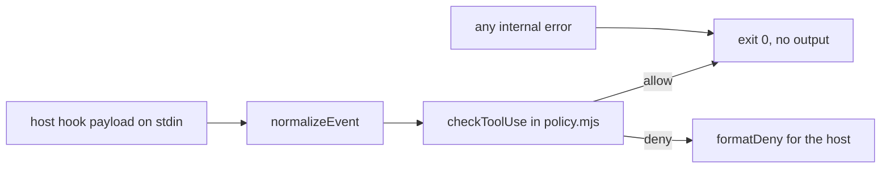

# Safety and policy

How port-any-game keeps to its legal stance in code: the data modes, the rights gate, the acknowledgements, the policy
rules, the agent hook adapter and the port's git hooks. Runtime instructions for agents live in
[legal.md](../skills/port-any-game/references/legal.md); the contribution bar is in [SCOPE.md](../SCOPE.md). This page
describes the code that enforces them. For where these layers sit in the whole system, see
[architecture.md](architecture.md).

## 1. The legal stance

**This is not legal advice.** Laws differ by country; the tool applies the strictest common rule everywhere.

- The game is the **user's own copy**. The tool reads that install, never fetches game data from elsewhere, and never
  redistributes it.
- **No DRM circumvention.** The survey reports DRM, activation, anti-tamper and anti-cheat as `STOP` and no lane is
  built for a `STOP` game (only `remote-play`, which is not built in M1). Crack, emulator and unpacker tooling is refused
  by the guard.
- **No game data in the repo.** Fixtures, the catalog and the repo itself carry no game files and no game-data URLs
  ([SCOPE.md](../SCOPE.md)). The catalog lists where to get open-source ports, not game data.
- **No telemetry** and no GPL code vendored into the plugin ([SCOPE.md](../SCOPE.md)).
- Grey areas (decompiling, asset extraction, lightly encrypted archives, store licences) need the user's explicit
  acknowledgement and stay private-use only. The per-jurisdiction notes are in
  [legal.md](../skills/port-any-game/references/legal.md) (based on research note
  [04](research/04-detection-and-legal.md)).

The defence is layered ([architecture.md](architecture.md)): skill instructions, the agent hook guard (section 5),
`pag` scripts that re-check policy themselves, and the port's git hooks (section 6). The guard is a safety net; the
scripts and git hooks stay authoritative.

## 2. Data modes and the rights gate

A port's `port.json` holds `data.mode`. A lane lists which modes it supports (`dataModes`); `pag new` writes the
lane's first one.

| Mode | Contents of `dist/` | Sharing |
|---|---|---|
| `byo` | No game files. The page imports the user's own copy into the browser on first start | Allowed on a static host (no game data) |
| `bundled` | A copy of the game files (for example an already-web game's own build) | **Private.** Stays on this computer; `pag package` prints a "Private copy" warning |
| `bundled-public` | Game files, built for sharing | Only when the rights gate passes |

`pag pack [portDir] [--mode byo|bundled|bundled-public]` defaults to `port.data.mode`, else `byo`. `byo` and `bundled`
must be in the lane's `dataModes`. `bundled-public` is lane-independent: it is gated only by the rights check
([pack.mjs](../skills/port-any-game/scripts/pack.mjs)). A `bundled-public` build also drops the `X-Robots-Tag:
noindex` header that private builds carry. See [runtime.md](runtime.md) for what pack writes.

### The rights gate: `isPublicAllowed`

[policy.mjs](../skills/port-any-game/scripts/policy.mjs) `isPublicAllowed(port)` is the single rule (R63). Public use is
allowed when either holds:

1. `port.data.redistributable === true`. `pag new` sets this only when the survey's catalog matches are all *sure*
   matches (not `needs_confirm`) and every one has `redistributable_data: true` in the catalog
   ([new.mjs](../skills/port-any-game/scripts/new.mjs) `freeToShare`). See [survey-and-catalog.md](survey-and-catalog.md).
2. `port.acks` holds an `ACK_RIGHTS_HOLDER` entry **with an `at` timestamp**. `pag ack` adds `at`; a hand-written entry
   without it does not count.

Nothing else unlocks public use. Owning or buying a copy is not holding the rights, and the agent never words the
statement for the user.

**`ACK_RIGHTS_HOLDER`** is recorded as:

```
pag ack ACK_RIGHTS_HOLDER <port> --note='<the user's own words>'     # sh/bash
pag ack ACK_RIGHTS_HOLDER <port> --note-env PAG_NOTE                  # PowerShell route
```

- The note is required for this ID (exit 2 without it) and is kept word for word as the audit trail.
- `--note-env` accepts only `PAG_*` variable names (`^PAG_[A-Z0-9_]+$`). `port.json` is tracked in git, so a secret
  such as a token must never be copyable into it. It exists because Windows PowerShell 5.1 drops `"` inside native
  command arguments.
- `--note` and `--note-env` together are a usage error. Recording is idempotent: a repeat prints "already recorded"
  and changes nothing, so a wrong note cannot be fixed later.
- pag echoes the stored note JSON-quoted so the agent can compare it with what the user said.

**Where the gate is checked**

| Place | Behaviour |
|---|---|
| `pack --mode bundled-public` | `PUBLIC_BUNDLED` (exit 4) unless allowed |
| [verify/static.mjs](../skills/port-any-game/scripts/verify/static.mjs) | a `bundled-public` shell fails the `public` check unless allowed |
| `assertTarget(port, 'public')` | `PUBLIC_BUNDLED`; no `pag` command calls the `public` target in M1 |
| guard: `git add/commit/push`, deploy tools | refused inside a port that is not public (section 4) |
| port git hooks | `check-staged.mjs` skips its scan only for a public port (section 6) |

**Persisting the mode.** After a successful `pack --mode bundled-public`, pack rewrites `port.json` so
`data.mode = "bundled-public"` (atomic temp-file rename). From then on the port counts as public: the guard stops
refusing git and deploy commands in it. The mode is a record; the gate itself is `isPublicAllowed`, not the mode.

## 3. Acknowledgements

`pag ack <ID> [portDir] [--note=... | --note-env VAR]` ([ack.mjs](../skills/port-any-game/scripts/ack.mjs)) appends
`{id, at, note?}` to `acks` in the nearest `port.json`. Only `pag` writes `port.json`: the guard blocks agent edits
(`PORT_JSON_WRITE`). The agent asks a plain question and runs `pag ack` only after a yes. Exit codes: 0 recorded or
already there, 1 failure, 2 usage (unknown ID, no `port.json`, bad flags). The write is atomic.

The survey lists the IDs a game needs in `verdict.required_acknowledgements`: the primary lane's `acks` plus
`ACK_UPX_PACKED` or `ACK_PROTECTION_WARN` for each warn-level protection
([verdict.mjs](../skills/port-any-game/scripts/survey/verdict.mjs)). Only two IDs are enforced by code
(`ACK_RIGHTS_HOLDER` in the gate, `ACK_WARN_BEYOND_LOOPBACK` in `serve --lan`); the rest are a record that the skill
asked and the user said yes. The exact questions are in [legal.md](../skills/port-any-game/references/legal.md).

| ID | Meaning | Required when |
|---|---|---|
| `ACK_PRIVATE_USE_ONLY` | The copy is for the user's private play, on their own devices, never posted | Every lane in M1 (`web-extract`, `known-port`, `rt-ruffle`, `dos-jsdos`) |
| `ACK_RUNTIME_LICENSE` | The build ships an open-source player (Ruffle, js-dos) whose licence text must stay with it if the build is ever given away | `rt-ruffle`, `dos-jsdos` |
| `ACK_UPX_PACKED` | The program is UPX-compressed; it is never unpacked automatically | The survey finds the `upx` protection (warn) |
| `ACK_PROTECTION_WARN` | A warn-level protection (for example a Steam API library on its own) stays untouched and may limit the browser build | The survey finds any other warn-level protection |
| `ACK_WARN_STORE_LICENSED` | A store copy is usually a licence, and its terms may limit modification | The survey shows a store (Steam, GOG, Epic) or the user says so |
| `ACK_WARN_LIGHTLY_ENCRYPTED` | Data is in lightly scrambled archives read by a player the way the original does; nothing is decrypted to disk | Runtime lanes with such archives (RPG Maker `.rgssad`, `.rpgmvp`, `.wolf`, `.xp3`) |
| `ACK_WARN_NETWORKING_DISABLED` | Online and multiplayer parts are switched off | The game has online parts |
| `ACK_WARN_PROPRIETARY_MIDDLEWARE` | Paid audio/video middleware (fmod, miles, bass, wwise, bink, smacker) is used only inside the private copy | The survey's `features.apis` lists such middleware |
| `ACK_WARN_BEYOND_LOOPBACK` | The port will be served beyond 127.0.0.1, password-protected, to the user's own devices only | Before `pag serve --lan`; **enforced** (`LAN_NO_ACK`) when the folder is inside a port |
| `ACK_GREY_ASSET_EXTRACT` | Copying the game's pictures and sounds out to rebuild it (legal grey area, private only) | Later lanes (not in M1) |
| `ACK_GREY_DECOMPILE` | Turning the program into new code (depends on country, private only) | Later lanes (not in M1) |
| `ACK_RIGHTS_HOLDER` | The user states in their own words that the game data is free to share or that they hold the rights | Only for public hosting; **enforced** by the rights gate; note required |

`ACK_IDS` in [ack.mjs](../skills/port-any-game/scripts/ack.mjs) is the full list of 12 accepted IDs. The IDs
`ACK_OS_LICENSE`, `ACK_CHEERPJ_TERMS` and `ACK_OWN_DEVICES_ONLY` appear on not-yet-built lane stubs
([lanes/stubs.mjs](../skills/port-any-game/scripts/lanes/stubs.mjs)) but are not in `ACK_IDS`, so `pag ack` would reject
them. A lane that ships must add its IDs there (see [lanes.md](lanes.md)).

## 4. Policy rules

[policy.mjs](../skills/port-any-game/scripts/policy.mjs) is the single authoritative guardrail (spec section 11). It
exports `checkToolUse({tool, command, path, url, cwd})` -> `{deny, reason, code}` for the guard, plus
`assertLaneAllowed`, `assertTarget` and `isPublicAllowed` for `pag` itself. A `PolicyError` makes `pag new`, `build`,
`pack` and `serve` exit 4; `pag survey` exits 4 for a `STOP` verdict. `checkToolUse` never throws a policy error: it
returns the deny and its `reason`, which is the text the agent shows the user.

| Code | Trigger | User-facing reason (summary) |
|---|---|---|
| `CIRCUMVENTION` | A command naming `steamless`, `noceg`, `steam_emu`, `smartsteamemu` anywhere; a command or executable-like path starting with `crack`, `goldberg`, `unlicense`, `nocd`, `no-cd`; a write creating `steam_api(64).dll`, `steam_emu.ini`, `smartsteamemu*` or `*.cdx` inside a port | DRM removal, emulation and crack tooling is refused; the skill never bypasses copy protection |
| `PIRACY_SOURCE` | A `magnet:` link or `.torrent` anywhere in a command or fetch URL; any host in [policy-domains.json](../skills/port-any-game/scripts/policy-domains.json) (exact or subdomain match, never substring) | Peer-to-peer or piracy/abandonware source; game data comes only from the user's own install or media |
| `GAME_DIR_WRITE` | A write (editor tool, redirect, `rm`, `mv`, `cp` destination, `tee`, `sed -i`, `tar -C`, `curl -o`, `Set-Content`, and similar) to a path inside `<port>/game/` | `game/` is the read-only original; work on a copy under `work/` |
| `PORT_JSON_WRITE` | A write to `<port>/port.json` | Only `pag` writes `port.json`; ask the user, who consents through `pag ack` |
| `GAME_LINK_DELETE` | A recursive delete (`rm -r`/`-rf`, `rmdir`, `rd /s`, `del`, `Remove-Item -Recurse` and aliases) whose target is a port folder or a folder above one (scan depth 4) | `game/` is a link to the real install, and on Windows PowerShell 5.1 a recursive delete follows it and deletes the game. The user removes the link first, then the folder |
| `PUBLIC_BUNDLED` | Inside a non-public port: `git add`/`stage`/`commit`/`push` that would include `game/ work/ build/ analysis/ dist/ extracted/ recomp/`; a deploy or publish command (`wrangler deploy`, `vercel`, `netlify deploy`, `firebase deploy`, `surge`, `gh-pages`, `butler push`, `npm/pnpm/yarn/bun publish` or a `deploy`/`publish`/`release` script, `gh release create/upload`, `aws s3 ... public-read`) run in or aimed at the port; `pack --mode bundled-public`; `assertTarget('public')` | The build contains game data and stays private; public use needs the rights, recorded by the user via `pag ack ACK_RIGHTS_HOLDER --note` |
| `GIT_HOOKS_BYPASS` | Inside a port: `git commit`/`push --no-verify`, `git commit -n`, `git -c core.hooksPath=...`, `git config core.hooksPath` (set or unset) | It would switch off the port's git hooks; never bypass them, tell the user why a hook refused |
| `STOP_VERDICT` | `assertLaneAllowed`: the survey verdict is `STOP` and the lane is not `remote-play` (called by `pag new`) | The lane is refused; only `remote-play` remains |
| `LAN_NO_PASSWORD` | `assertTarget` for `lan`: no password (`pag serve --lan` needs `--password-env VAR`) | Serving beyond 127.0.0.1 needs a password |
| `LAN_NO_ACK` | `assertTarget` for `lan`, in a port without a timestamped `ACK_WARN_BEYOND_LOOPBACK` | Ask the user, then `pag ack ACK_WARN_BEYOND_LOOPBACK` |

How the shell check works (`shellCheck`):

- The command line is split into segments at `; | & ( ) \` newline`, with quotes honoured and backslashes literal
  (Windows paths). Env assignments, runners (`sudo`, `env`, `npx`, `time`...) and package-manager exec wrappers are
  stripped to find the real command.
- Message and body values are prose and never scanned: `git commit -m/-F`, `gh pr|issue|release --body/--title/...`.
  Heredocs are removed for such commands.
- `cd` / `pushd` / `Set-Location` track a working directory. `bash -c`, `sh -c`, `cmd /c`, `powershell -Command` and
  similar re-check their inner command (depth 3).
- `~`, `$HOME`, `%USERPROFILE%`, `$env:USERPROFILE` resolve to the home folder. Paths compare case-insensitively on
  Windows and macOS.
- A port is the nearest `port.json` at or above the path whose `schema` is missing or starts with
  `port-any-game/port@`; someone else's `port.json` is ignored. An unreadable `port.json` is treated as `byo`, never
  public.
- Git checks ask git itself where needed (`git add --dry-run`, `git ls-files`, `git diff --name-only`, 5 s timeout) so
  `.gitignore` is respected; `git push` is refused when any protected path is tracked.
- The `fetch` tool kind is checked for piracy hosts only.

## 5. The guard

[guard.mjs](../skills/port-any-game/scripts/guard.mjs) is the hook adapter behind `pag guard --host=<x>`. It reads one
agent hook payload on stdin (a UTF-8 BOM is stripped), normalises it, calls `checkToolUse`, and denies in the host's
format. The default host is `claude`.



### Input formats (`normalizeEvent`)

| Shape recognised | Host |
|---|---|
| `tool_name` / `toolName` + `tool_input` / `toolArgs` / `toolInput` (an object or a JSON string; plain text is read as a command) | Claude Code, Codex, Copilot, Gemini |
| `toolCall: {name, args}` | Antigravity |
| `{action, resources: [...]}` | OpenCode v2 (`permission.evaluate`) |
| `{input: {tool}, output: {args}}` | OpenCode v1 (`tool.execute.before`) |
| top-level string `command` with no tool name | Cursor `beforeShellExecution` |

Tool names are mapped to three kinds (case-insensitive): shell (`bash`, `powershell`, `run_shell_command`,
`exec_command`, ...), write (`write`, `edit`, `multiedit`, `notebookedit`, `apply_patch`, `str_replace_editor`, ...) and
fetch (`webfetch`, `fetch`, ...). Anything else is allowed. The command, path or URL and the working directory come from
the first non-empty of the known field names (`command`/`cmd`/`CommandLine`, `file_path`/`path`/`target_file`,
`cwd`/`workdir`/`working_directory`, workspace roots, then the process cwd). For Codex `apply_patch`, the paths come from
the `*** Add/Update/Delete File:` and `*** Move to:` lines of the patch text. Every path in a multi-path event is checked.

### Deny output (`formatDeny`)

| Host value | Output | Exit |
|---|---|---|
| `copilot` | stdout JSON `{permissionDecision: "deny", permissionDecisionReason}` | 0 |
| `antigravity`, `agentplugins` | stdout JSON `{decision: "deny", reason}` | 0 |
| `codex` | stdout JSON `{hookSpecificOutput: {hookEventName: "PreToolUse", permissionDecision: "deny", permissionDecisionReason}}` | 0 |
| anything else (`claude`, `cursor`, `gemini`, ...) | the reason on stderr | 2 |

Codex denies with JSON at exit 0 so the result does not depend on the Windows shell (spike
[b](spikes/b-hooks-windows.md): a PowerShell hook command loses exit code 2, so the Claude exec form and
`; exit $LASTEXITCODE` forms matter). OpenCode does not use `pag guard`: its plugin imports `policy.mjs` and
`guard.mjs` directly and denies through the host API (see [agent-integration.md](agent-integration.md)).

### Fail-open, and why

Any internal error in the adapter (bad JSON, a throw in `policy.mjs`, a failed import) prints
`pag guard: internal error, allowing: ...` on stderr and exits 0. The policy module is imported late for this reason.
[pag.mjs](../skills/port-any-game/scripts/pag.mjs) also exits 0 if `guard.mjs` itself cannot load. The OpenCode plugin
does the same and logs `guard disabled` when it cannot find the skill. The reasoning: a broken guard must not lock the
agent out of every tool call (Copilot hooks are fail-closed on a crash, which is why the Copilot commands end in
`|| true` / `; exit 0`). Safety does not rest on the guard alone: `pag` scripts re-check policy, and the port's git
hooks stop game data at commit and push.

## 6. The port's git hooks

`pag new` copies the assets from
[assets/project/githooks/](../skills/port-any-game/assets/project/githooks) into `<port>/.githooks/` and runs
`git config core.hooksPath .githooks` in the new repository. If git is missing it warns and skips the hooks; run
`git init` and set `core.hooksPath` later. The port's [gitignore](../skills/port-any-game/assets/project/gitignore)
excludes `game/ work/ build/ dist/ analysis/ verify/ node_modules/ package/`.

- `pre-commit` runs `node .githooks/check-staged.mjs` (staged files).
- `pre-push` runs `node .githooks/check-staged.mjs --push "$@"` (every commit being pushed, read from stdin).
- [check-staged.mjs](../skills/port-any-game/assets/project/githooks/check-staged.mjs) is standalone with no
  dependencies, because it runs inside the port without the skill. For each file it refuses (exit 1) when:
  - it starts with a game magic string (`MZ`, `GDPC`, `RGSSAD`, `XP3`, `UnityFS`, `RPA-`, `IWAD`, `PWAD`, `PACK`, `FWS`,
    `CWS`, `ZWS`, `BIK`, `SMK`, `XFIR`, `RIFX`, and others in `MAGICS`);
  - its SHA-256 matches a non-partial hash in the port's `survey.json`;
  - it is over 5 MiB and looks binary (a NUL in the first 8000 bytes).
- The whole check is skipped when the port is public: `data.redistributable === true` or a timestamped
  `ACK_RIGHTS_HOLDER`. It inlines the same rule as `isPublicAllowed`; change both together.
- Keep the port's repository private: `survey.json` holds only relative paths, but its hashes identify the game.

The port's own [AGENTS.md](../skills/port-any-game/assets/project/AGENTS.md) states the matching rules for agents
(read-only `game/`, no recursive delete, no `--no-verify`, no hand edits to `port.json`).

## 7. Known guard limits

The guard parses command text; it does not run a shell. These gaps are known and tracked in
[roadmap.md](roadmap.md) (Policy and guard). The port's `AGENTS.md` rules and the git hooks are the backstops.

- **Piped deletes.** `Get-ChildItem <port> | Remove-Item -Recurse` passes; `GAME_LINK_DELETE` sees only targets named on
  the command line.
- **Variable and list targets.** `rm -rf $p` and comma lists such as `"a","b"` pass.
- **Option abbreviations.** `git commit --no-veri` passes because git accepts unambiguous long-option abbreviations;
  `git commit -uno` is wrongly read as `-n` and denied.
- **Glob widening is conservative.** A glob target makes its folder the target, so `rm -r *.log` in a port root is
  denied.
- **Hook value `.githooks`.** `git config core.hooksPath .githooks`, which `pag new` suggests when git was missing, is
  denied.
- **Other holes.** Absolute-path `git add` from outside the port, `bash -ec`, `node -e` and `~user` are not modelled;
  `GAME_DIR_WRITE` and the emulator-file check cover only `<port>/game/`, not a separately resolved install path;
  `git rebase`, `cherry-pick` and `--amend` are not modelled.
- **Not every action is a tool call.** The guard sees agent tool calls only: user-initiated shell commands do not reach
  it (spike [c](spikes/c-opencode-guard.md)), and it does nothing where no hook is installed (for example skills-only
  hosts).
